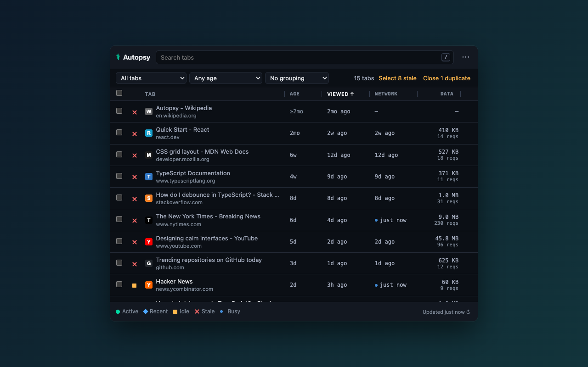
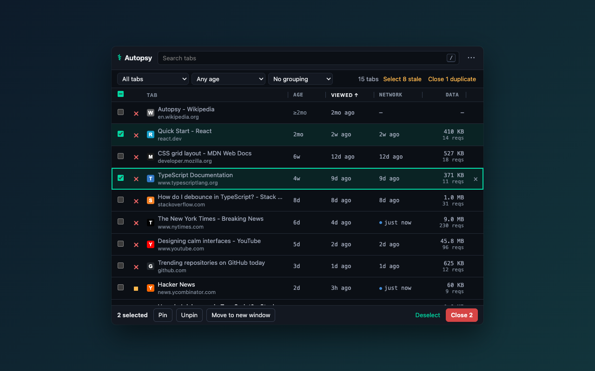
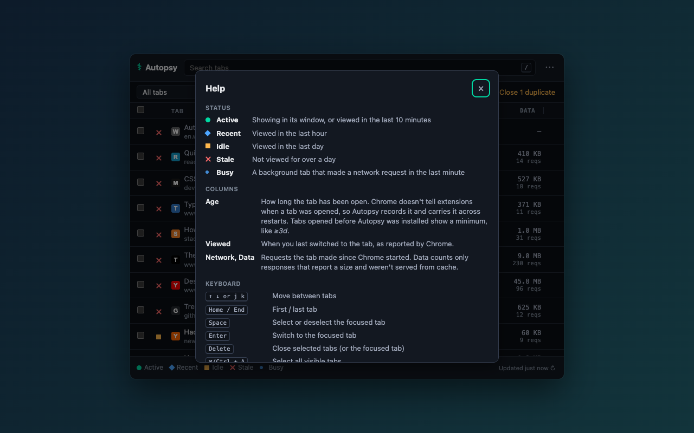
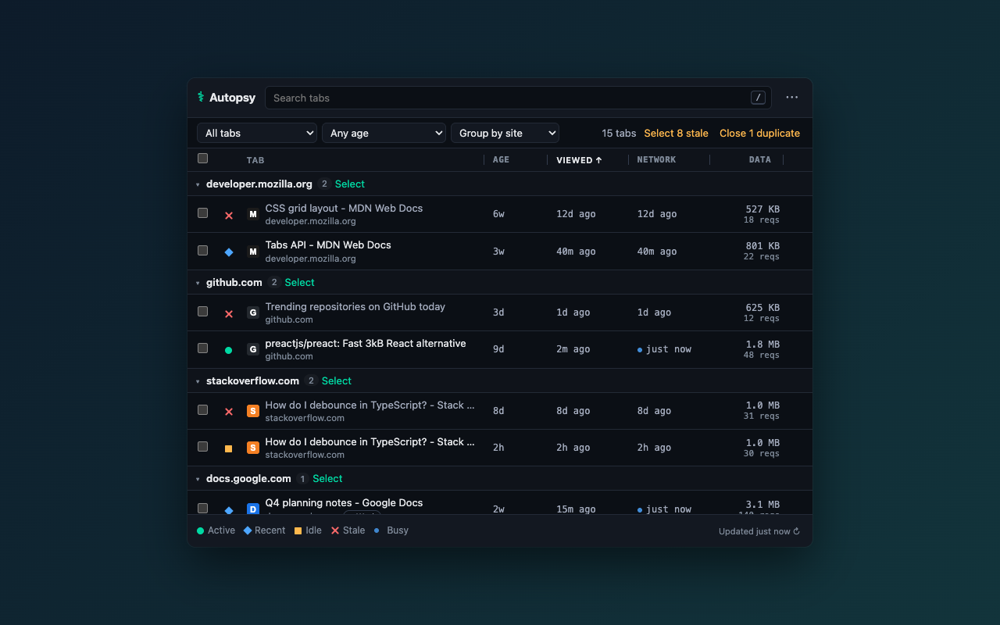
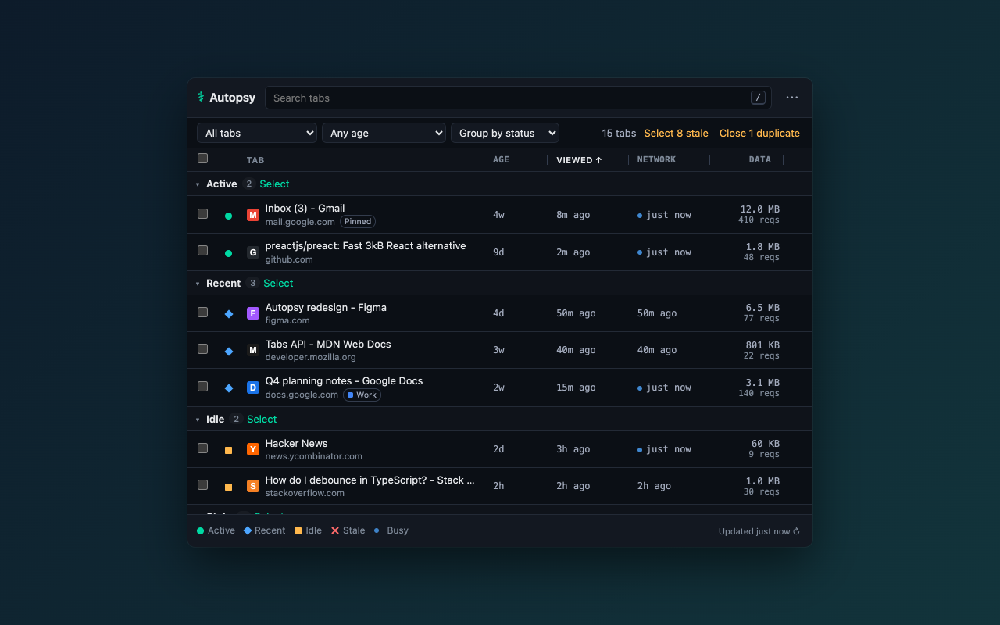
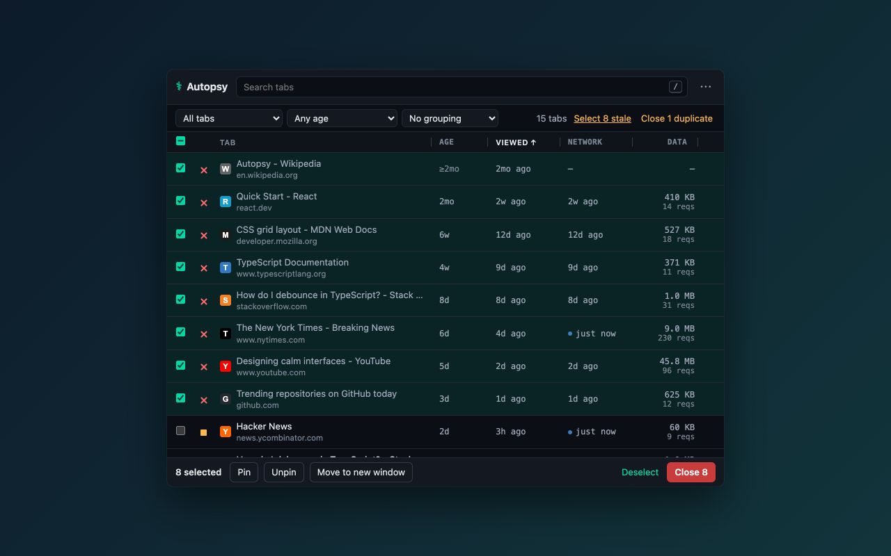
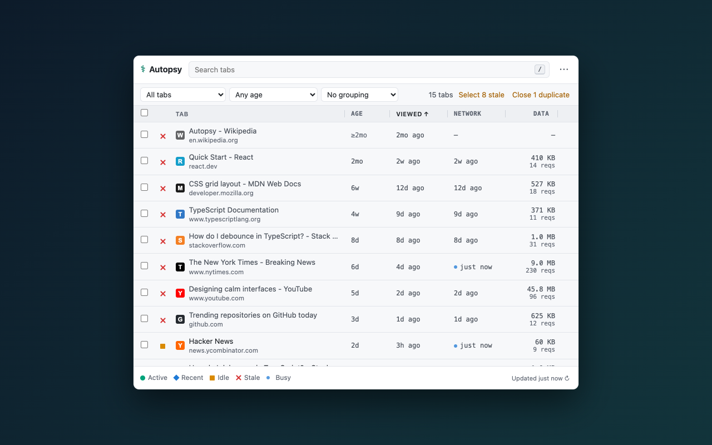
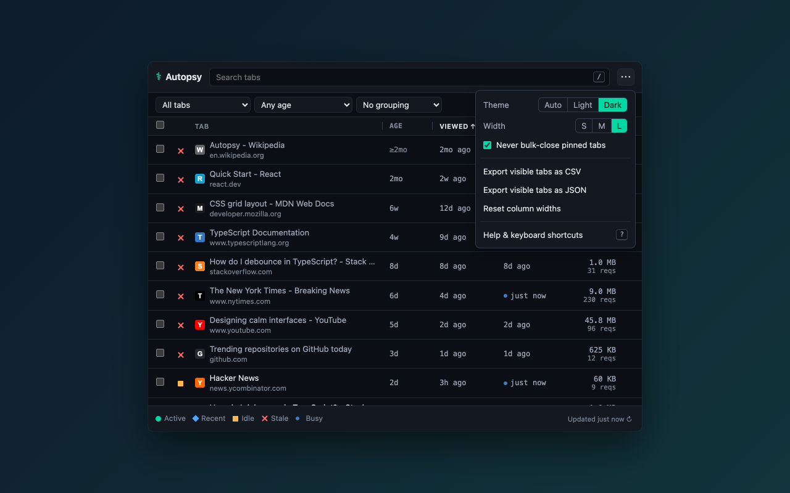

# Autopsy

[](CHANGELOG.md)
[](LICENSE)
[](https://chromewebstore.google.com/detail/autopsy/fmlkjcobafbejgpkjkcgbhfgnlpdkegn)

> **Postmortem analysis for your tabs.** Find what to close.

Autopsy is a small Chrome extension that shows, for every open tab, how long it has been open, when you last looked at it, and whether it's still busy on the network. Then it helps you close the ones you don't need, with undo.



## What it shows

| Column | Meaning |
| --- | --- |
| **Status** | How stale the tab is, from when you last viewed it: ● **Active** (showing in its window, or viewed under 10 minutes ago) · ◆ **Recent** (under 1 hour) · ■ **Idle** (under 1 day) · ✕ **Stale** (over 1 day). |
| **Age** | How long the tab has been open. See [How tab age works](#how-tab-age-works). |
| **Viewed** | When you last switched to the tab, from Chrome's own `lastAccessed`, which survives restarts. |
| **Network** | When the tab last made a network request. A pulsing dot marks background tabs that are still **busy**. |
| **Data** | Bytes received and requests made since Chrome started. Counts only responses that report a size and weren't served from cache. |

Badges mark **Pinned**, **Audio**, **Asleep** (unloaded by Chrome) and Chrome tab groups.

## What it does

- **Search, filter and group.**
  - Search by title or URL.
  - Show *all*, *stale only*, *idle or stale*, or *busy in background* tabs.
  - Filter by minimum age.
  - Group by site, window or status, with collapsible groups.
- **Close what you don't need.**
  - One click to *Select N stale* or *Close N duplicates*. Duplicates keep the copy you viewed most recently.
  - Close any row with its × button.
  - **Every close can be undone** (⌘/Ctrl+Z or the toast). Undo reopens tabs in their original window and position.
- **Bulk actions** on selected tabs: pin, unpin, move to a new window, close.
  - Bulk actions only apply to tabs you can see; hidden rows drop out of the selection.
  - Pinned tabs are never bulk-closed unless you turn that off.
- **Export** the visible tabs to CSV or JSON.
- **Settings** (⋯ menu): theme (auto/light/dark), popup width (S/M/L), pinned-tab protection, column-width reset. Columns can be resized by dragging their borders.

### Keyboard

| Keys | Action |
| --- | --- |
| `↑` `↓` / `j` `k`, `Home` `End` | Move between tabs |
| `Space` | Select or deselect the focused tab |
| `Enter` | Switch to the focused tab |
| `Delete` / `Backspace` | Close selected tabs (or the focused tab) |
| `⌘/Ctrl+A` | Select all visible tabs |
| `⌘/Ctrl+Z` | Undo the last close |
| `/` or `⌘/Ctrl+F` | Search (`↓` from search jumps to the list) |
| `Esc` | Close a dialog, then clear focus, search, selection |
| `?` | Help |

## How tab age works

Chrome doesn't give extensions a tab's creation time. The tabs API only exposes `lastAccessed`, the last time a tab became active, so Autopsy keeps its own record:

- When a tab opens, the service worker records the time. Navigating, including in-page navigation in single-page apps, never resets it.
- On a browser restart, tab and window IDs all change. For about 10 minutes after startup, restored tabs are matched to the previous session's records by URL, then by window and tab position, and keep their original open time.
- Tabs that existed before Autopsy was installed have no known open time. They show a minimum, such as `≥3d`, based on when Autopsy first saw them or when you last viewed them, whichever is earlier.

Network stats are kept in `chrome.storage.session`. They survive Chrome stopping the idle service worker, and reset when the browser restarts.

## Screenshots

<details>
<summary>More screenshots</summary>

| | |
| --- | --- |
|  |  |
|  |  |
|  |  |
|  | |

</details>

## Install

**[Chrome Web Store →](https://chromewebstore.google.com/detail/autopsy/fmlkjcobafbejgpkjkcgbhfgnlpdkegn)** (Chrome 121 or later)

### From source

```bash
git clone https://github.com/scttfrdmn/autopsy.git
cd autopsy
npm install
npm run build
```

Then open `chrome://extensions`, enable **Developer mode**, click **Load unpacked**, and choose `dist/`. During development, `npm run dev` rebuilds `dist/` on every change; reload the extension to pick it up.

## Privacy

Everything stays on your device: no servers, accounts, analytics or external requests. Autopsy stores tab open times and your preferences in `chrome.storage.local`, and network counters in `chrome.storage.session`. See [PRIVACY.md](PRIVACY.md).

## Development

| Command | What it does |
| --- | --- |
| `npm run build` | Type-check and build to `dist/` |
| `npm run dev` | Rebuild `dist/` on change |
| `npm test` | Unit tests (Vitest) |
| `npm run test:e2e` | Build, then end-to-end tests in Chromium with the extension loaded (Playwright) |
| `npm run lint` / `npm run format` | ESLint / Prettier |
| `npm run package` | Build and zip `dist/` into `autopsy-v<version>.zip` for the store |
| `npm run screenshots` | Build the screenshot variant and capture store screenshots into `screenshots/` |
| `npm run promo` | Render the promo tile and marquee from `assets/promo-*.html` |
| `npm run cws -- status` / `submit` | Check the Chrome Web Store item, or upload the packaged zip and submit it for review (see below) |

The end-to-end tests need Playwright's Chromium (`npx playwright install chromium`). They put browser profiles in `~/.xtmp` when it exists, otherwise in the OS temp directory.

### Publishing

`npm run package && npm run cws -- submit` uploads `autopsy-v<version>.zip` and submits it for review through the Chrome Web Store API v2. Add `--dry-run` to only run the checks, or `--staged` to hold the approved version until you publish it in the dashboard. It authenticates by impersonating the `cws-publisher` service account in the `autopsy-publishing` Google Cloud project with `gcloud` (no key file), so you need a current `gcloud auth login` with Token Creator rights on that account. IDs are in `scripts/cws.config.json`. The full release checklist is in [RELEASING.md](RELEASING.md). The API only uploads packages; listing text and images are still edited in the dashboard (see `STORE_LISTING.md`).

### Layout

```
src/
├── background/worker.ts     # Service worker: tab records, network stats, snapshot messages
├── lib/                     # Pure logic, unit-tested
│   ├── tabRecords.ts        #   Open-time tracking and restart matching
│   ├── status.ts            #   Staleness, busy, age
│   ├── view.ts              #   Filter, sort, group, duplicates
│   ├── export.ts format.ts url.ts constants.ts
├── popup/
│   ├── App.tsx              # State, actions, keyboard
│   ├── actions.ts           # Chrome tab operations (close/restore/pin/move)
│   ├── hooks/               # useTabs, usePreferences, useTheme, useNow
│   ├── components/          # Toolbar/Controls/Footer, TabTable, TabRow, Menu, Dialogs
│   └── popup.css
└── types/index.ts
tests/
├── unit/                    # Vitest
└── e2e/                     # Playwright (keyboard, undo, pinned protection, restart)
```

## Contributing

Issues and pull requests are welcome. Please run `npm run lint`, `npm test` and `npm run test:e2e` before opening a PR. See [ROADMAP.md](ROADMAP.md) for what's planned.

## License

MIT. See [LICENSE](LICENSE).

**Support:** info@autopsy.tools · **Issues:** [GitHub](https://github.com/scttfrdmn/autopsy/issues) · **Website:** [autopsy.tools](https://autopsy.tools)
